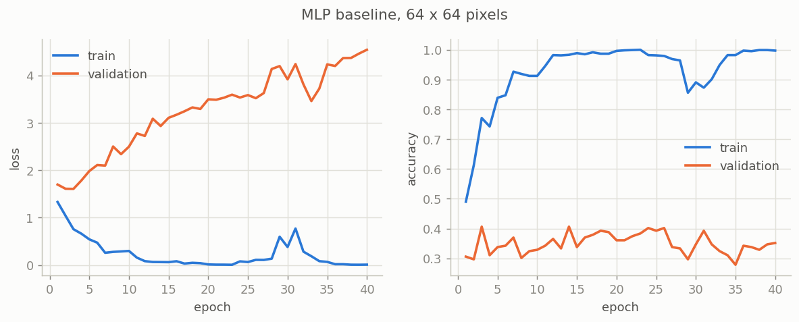
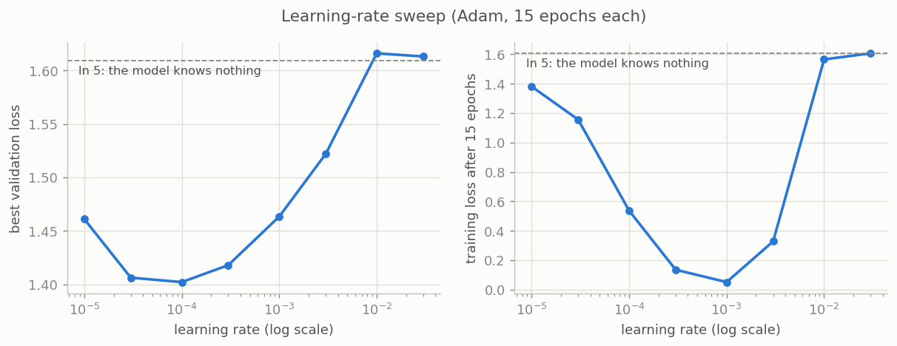
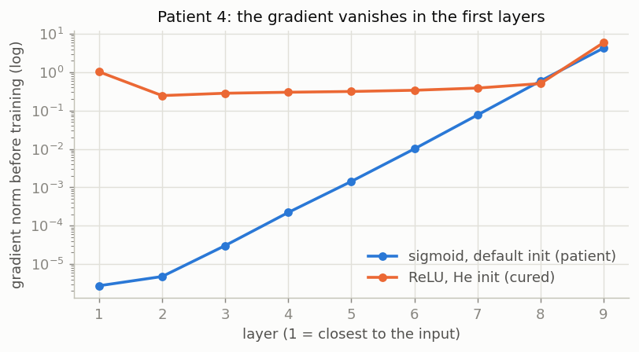
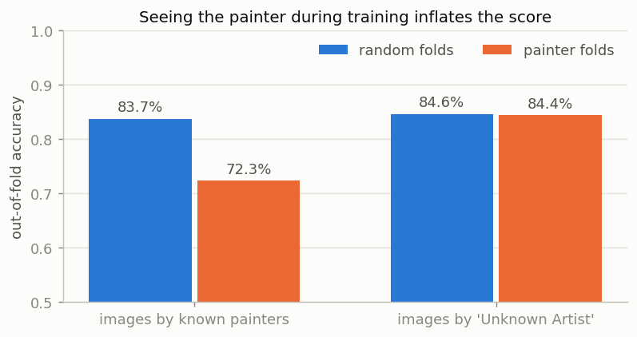
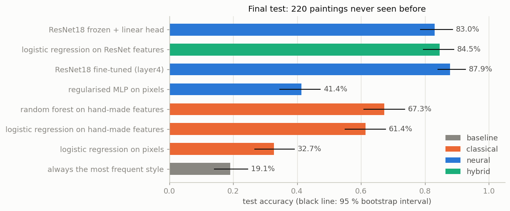
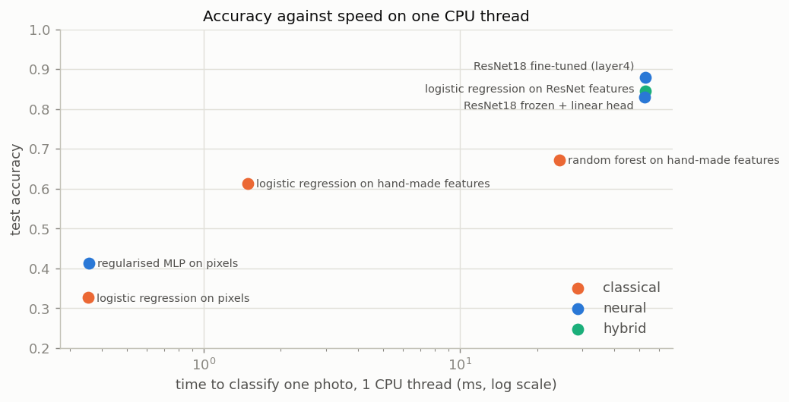

# Museum Guide: recognising painting styles with neural networks

Final project of the course *Neural Networks & Deep Learning Foundations* (MSA-DATB09-03, Albert School).

## The story

We work in the AI team of a (fictional) French fine-arts museum. The museum wants a guide on visitors'
phones and on kiosks in the galleries. A visitor points the camera at a painting, and the guide tells
them its **style** (Impressionism, Baroque, Cubism...) and the story of that movement.

The kiosks have small CPUs, the team is small and the budget is limited. So the director asks one clear
question: **is a neural network worth it in production, or would a simpler classical model do the job?**

Our rules: networks built from PyTorch primitives (no "magic" training library), every number measured,
every claim backed by evidence.

## What we build

| Part | What it is | Where |
|---|---|---|
| 1 | A feed-forward network (MLP) in PyTorch that classifies paintings from their pixels | [02_mlp](notebooks/02_mlp.ipynb) |
| 2 | Training monitoring (curves, gradients, dead neurons, learning rate) and regularisation | [03_monitoring](notebooks/03_monitoring.ipynb) |
| 2 | Failure diagnosis: four broken runs, diagnosed and fixed | [04_training_doctor](notebooks/04_training_doctor.ipynb) |
| 3 | A pretrained CNN (ResNet18) used as a feature extractor and fine-tuned | [05_resnet](notebooks/05_resnet.ipynb) |
| 4 | Classical models, the final test, CPU speed tests and our recommendation to the director | [06_final_comparison](notebooks/06_final_comparison.ipynb) |
| Bonus | Transformers (ViT, CLIP) against ResNet18, on validation | [07_transformers](notebooks/07_transformers.ipynb) |

## Our answer to the director, in short

**Yes, a neural network is worth it, but a pretrained one that we reuse (ResNet18, frozen, with a linear
head), not one we train from zero.** On 220 paintings never seen before, it reaches **83.0 %**, against
**67.3 %** for the best classical model and 41.4 % for our MLP on pixels. It classifies one photo in about
53 ms on one CPU thread and trains in 17 s on a laptop, without a GPU. Details and limits:
[see below](#final-test-and-recommendation).

## Data

We use a small subset of [WikiArt](https://huggingface.co/datasets/huggan/wikiart): **5 styles x 300
images** (Impressionism, Baroque, Cubism, Ukiyo-e, Pop Art), resized to 224 x 224 pixels.

The images are **not** in this repository: their licence is unknown, so we only share the script and
the exact command. To rebuild the same data:

```bash
pip install -r requirements.txt
bash scripts/get_data.sh          # about 8.4 GB streamed once, about 40 MB written to data/
```

`scripts/get_data.sh` explains each option. In short: the dataset revision and the random seed are
fixed, so everybody gets the same 1 500 images, and one painter gives at most 50 images, so that the
model learns the style and not the painter.

**Our split** ([notebook 01](notebooks/01_data.ipynb)): 1 061 images to train, 219 to validate and
220 to test, with the same share of each style in each part. All the images of a known painter go to
the same part (0 known painter in two parts, against 23 of 32 with a random split), so the scores
measure the style and not the memory of a painter. The test set is used only once, at the very end.
The split is saved in [reports/split.csv](reports/split.csv).

## Validation results (notebooks 02 to 05)

| Model | Validation accuracy | Notes |
|---|---|---|
| Always the most frequent style | 22.8 % | the chance level |
| MLP on 64 x 64 pixels (6.4 M parameters) | 40.6 % (best epoch: 3) | 99.7 % on train at the end: strong overfitting |
| MLP on 16 / 32 / 64 pixels, mean of 3 seeds | 39.4 / 39.0 / 37.1 % | more pixels do not help an MLP |
| Regularised MLP, 32 x 32 pixels, mean of 3 seeds | **45.5 %** (std 0.7) | train/validation gap 0.12 instead of 0.61 |
| Frozen ResNet18 + linear head (linear probe), 3 seeds | **88.1 %** (std 0.0) | only 2 565 trained parameters |
| Frozen ResNet18 + small MLP head, 3 seeds | **89.2 %** (std 1.1) | same as the linear probe within the noise |
| ResNet18 with `layer4` fine-tuned, 3 seeds | 85.4 % (std 0.5) | 8.4 M trained parameters: overfits, and much slower |

Sanity checks ([notebook 02](notebooks/02_mlp.ipynb)): the first loss is 1.591, close to ln 5 = 1.609
(after shrinking the last layer, see the notebook), and the model learns one batch of 32 images by
heart (100 %). Every number comes from [reports/results/](reports/results/).



## Training monitoring

[Notebook 03](notebooks/03_monitoring.ipynb) looks inside the network during training: the gradient of
each layer, the share of dead neurons and the size of the weights, not only the loss.

- **The baseline is healthy but overfits.** The gradient reaches every layer and only about 4 % of the
  neurons are dead, but the training loss falls to 0.008 while the validation loss rises from 1.54 to 4.06.
- **Learning rate.** A sweep of 8 values gives a U-shaped validation loss. The best value is 0.0001; Adam's
  usual 0.001 overfits after 2 epochs, and 0.01 or more breaks the network.
- **Regularisation.** Weight decay, dropout, batch norm, flips and early stopping each help a little.
  All together they lift the MLP from 38.8 % to 45.5 % and shrink the train/validation gap from 0.61 to 0.12.
- **Errors.** The MLP recognises colours (dark Baroque: recall 69 %), not shapes (Cubism: recall 7 %).



## Failure diagnosis

[Notebook 04](notebooks/04_training_doctor.ipynb) breaks the training on purpose four times, then
diagnoses and fixes each run. Every number below was measured there.

| Patient | Symptom (measured) | Cause | Cure | After the cure |
|---|---|---|---|---|
| Learning rate too big (Adam 0.01) | loss stuck near ln 5, 212 of 219 images predicted Baroque, over 99 % of layer-2 neurons dead; with SGD at lr 1, `nan` at mini-batch 8 | steps so big that the ReLU neurons die or the weights blow up | learning rate 0.0001 (from the sweep) | 43.8 % validation, 0.4 % dead neurons |
| `zero_grad()` forgotten | loss jumps to 4.94, then one class only (19.2 %) | gradients add up: the norm is 26 times bigger after 2 epochs | `optimizer.zero_grad()` before `backward()` | smooth loss, 41.1 % validation |
| Raw pixels (0 to 255) | first loss 16.3 instead of 1.6; SGD loss up to 3 x 10^8; Adam noisy (35.2 %) | inputs dozens of times too big | standardise with the training mean and std | first loss 1.610, 43.8 % validation |
| 8 sigmoid layers | loss stuck at 1.609 = ln 5, 19.2 % | vanishing gradient: layer 1 gets 6 x 10^-7 of the gradient of layer 9 | ReLU and He initialisation | ratio 0.17, 39.3 % validation |

A loss stuck at ln 5 can mean dead neurons (patient 1) or a vanishing gradient (patient 4): only the
monitor tells them apart.



Three more failures are **silent**: nothing crashes and the training curves look normal. We measured
them with the ResNet in [notebook 05](notebooks/05_resnet.ipynb):

| Silent failure | Measured effect | Cure |
|---|---|---|
| Features extracted without `model.eval()` (batch norm uses the statistics of each batch) | 12.8 % instead of 88.1 % on validation | always call `model.eval()` before extracting or predicting |
| Pixels not normalised with the ImageNet mean and std | 81.7 % instead of 88.1 % | use the statistics the network was trained with |
| The same painter in training and in evaluation (painter leakage) | +11.4 points on images by known painters (83.7 % against 72.3 %, same images), no change on the control group | split the data by painter (notebook 01) |

## Pretrained ResNet18

[Notebook 05](notebooks/05_resnet.ipynb) reuses ResNet18, a convolutional network already trained on
ImageNet (1.2 million photos). The network comes from torchvision; the heads, the freezing of the
blocks and the training loop are ours.

- **Frozen features + a linear head** (a "linear probe"): each painting becomes 512 numbers, computed once
  (15.5 ms per painting on a laptop CPU), and only 2 565 parameters are trained. **88.1 %** on validation,
  almost twice our best MLP.
- **Fine-tuning the last block** (8.4 million trained parameters, with random crops and flips): 85.4 %.
  It overfits 1 061 images and takes 1.7 to 3.6 minutes of training per run, against 0.4 s for the
  linear probe, so the frozen features win here.
- **Errors**: Ukiyo-e is always found; Cubism is the hardest style (recall 71 %, against 7 % for the MLP),
  mostly confused with Pop Art.



## Final test and recommendation

[Notebook 06](notebooks/06_final_comparison.ipynb) trains classical models (no neural network), trains
our neural models again with the same recipes (the validation scores match notebooks 03 and 05
exactly), then scores every model **once** on the 220 test paintings. The interval is a 95 % bootstrap
interval: with only 220 paintings, a score can move by about 5 points just by chance. For the models
trained with 3 seeds, the accuracy is the mean of the seeds and the interval comes from seed 0. The
times are medians over 50 photos, one photo at a time, including the resizing and the features.

| Model | Family | Test accuracy (95 % interval) | Time per photo, 1 CPU thread | Model file |
|---|---|---|---|---|
| Always the most frequent style | baseline | 19.1 % | | |
| Logistic regression on pixels | classical | 32.7 % (26.8 to 39.1) | 0.35 ms | 0.1 MB |
| Logistic regression on hand-made colour and texture features | classical | 61.4 % (55.0 to 67.7) | 1.5 ms | 0.006 MB |
| Random forest on hand-made features | classical | 67.3 % (60.9 to 73.6) | 24 ms | 26 MB |
| Regularised MLP on pixels (ours), 3 seeds | neural | 41.4 % (34.5 to 47.3) | 0.36 ms | 6.8 MB |
| ResNet18 frozen + logistic regression | hybrid | 84.5 % (79.5 to 89.1) | 53 ms | 45 MB |
| **ResNet18 frozen + linear head (ours), 3 seeds** | neural | **83.0 %** (78.6 to 88.6) | 53 ms | 45 MB |
| ResNet18 with `layer4` fine-tuned, 3 seeds | neural | 87.9 % (84.1 to 92.7) | 53 ms | 45 MB |

- **The pretrained network wins clearly**: the frozen ResNet + linear head is 16.4 points better than the
  random forest (interval of the difference: 9.1 to 24.1 points, on the same test paintings).
- **Frozen or fine-tuned?** The validation and the test disagree (88.1 % against 85.4 % on validation, 83.0 %
  against 87.9 % on test): with about 220 paintings per set, our data cannot separate them. We chose the
  frozen model on validation, before the test, and we keep it; fine-tuning is the first thing to try again
  with more data.
- **Speed is not a problem**: every model classifies a photo in well under a tenth of a second on one
  CPU thread.



**Our recommendation**: ResNet18 frozen, with a linear head.

- It is much more accurate than any classical model: about one visitor in six gets a wrong style, against
  one in three.
- It is fast enough for a modest CPU.
- It is cheap to maintain for a small team: the ResNet is used as downloaded, and only a small layer is
  trained, in seconds, when the collection changes.

**Before production**:

1. Test it on a few hundred real photos taken at the kiosks (angles, reflections, frames).
2. Add more styles and more paintings.
3. Measure the speed on the real kiosk hardware.

Our MLP on pixels and the classical models alone are not accurate enough for a museum guide.



## Bonus: what about transformers (BERT)?

BERT reads words, not pixels, so it cannot classify paintings by itself. [Notebook 07](notebooks/07_transformers.ipynb)
tests its two image cousins as frozen feature extractors, with the same split and the same linear head as
ResNet18. These are **validation** numbers: the test set was used once, in notebook 06, and stays closed.

| Frozen network | Validation accuracy (219 paintings) | Time per photo vs ResNet18 | Parameters |
|---|---|---|---|
| ResNet18 + linear head (our choice) | 88.1 % | x 1 | 11 M |
| ViT-B/16 (the BERT architecture on 16 x 16 image patches) + linear head | 88.1 % | x 9 | 86 M |
| CLIP ViT-B/32, zero-shot (no training: one sentence per style) | 89.0 % | x 2.7 | 151 M (88 M for images) |
| CLIP ViT-B/32 + linear head | **94.7 %** | x 2.7 | 151 M (88 M for images) |

- ViT is as accurate as ResNet18 and 9 times slower: no gain.
- CLIP, trained on 400 million images with their captions, is 6.8 points better than ResNet18 on the same
  validation paintings (paired interval 2.3 to 11.4). But it has very probably seen WikiArt during its training,
  and it is a bigger, slower model. It is our first next step: test it on real kiosk photos. It also links
  sentences to images, so it could answer visitors' questions (part 2 of the brief).

## How to run

```bash
pip install -r requirements.txt
bash scripts/get_data.sh                  # once: builds data/wikiart_style5
python -m pytest                          # automatic checks
python scripts/run_notebooks.py           # rebuilds and runs every notebook (FAST_RUN=1 for a quick check)
```

The notebooks are stored twice: the `.py` file is the source (easy to read in a Git diff) and the
`.ipynb` file is the same notebook with its outputs. Everything runs on a laptop CPU.

## Presentation and study guide

- [docs/museum_guide_presentation.pptx](docs/museum_guide_presentation.pptx): the 10-minute defence (10 slides,
  6 backup slides, speaker notes). In this public copy the paintings of the title slide are replaced by colour
  squares (WikiArt licence).
- [docs/oral_study_guide.pdf](docs/oral_study_guide.pdf) ([.docx](docs/oral_study_guide.docx)): every step, every
  number, a glossary and the questions we expect, with short answers.

## Repository structure

```
make_wikiart_subset.py   builds the data subset (script given by the course)
scripts/                 the exact data command, and a script that runs all the notebooks
src/museum_guide/        our Python code (data, models, training loop, diagnostics)
notebooks/               the experiments, run in order (01 to 06, then the bonus 07)
tests/                   small automatic checks (data split, model, training loop)
reports/                 figures, the split and every measured result (JSON), no artwork images
docs/                    the presentation and the oral study guide
```

## Project status

- [x] Repository and data subset
- [x] **m1**: data split and a first MLP baseline
- [x] **m2**: monitoring curves and failure diagnosis
- [x] **m3**: pretrained ResNet18 (feature extractor, fine-tuning, painter leakage)
- [x] **v1.0**: classical models, CPU benchmark, final test and recommendation
- [x] Bonus: transformers (ViT, CLIP) on validation
